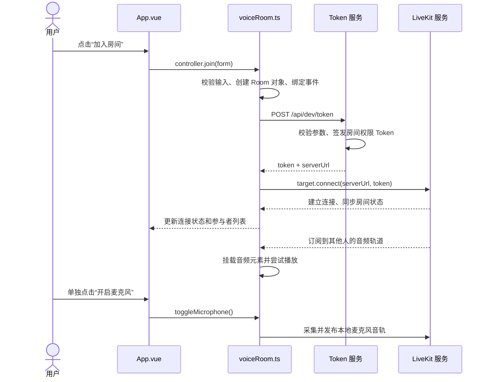

# 点击“加入房间”后的处理流程

本文根据当前项目代码说明：用户点击按钮后，前端如何获取 Token、连接 LiveKit、接收音频，以及取消或离开时如何清理资源。

## 1. 相关代码入口

| 文件 | 职责 |
| --- | --- |
| [App.vue](frontend/src/App.vue) | 表单、按钮事件、状态展示及页面生命周期 |
| [voiceRoom.ts](frontend/src/services/voiceRoom.ts) | `join()`、房间事件、音频播放和连接清理 |
| [token.ts](frontend/src/services/token.ts) | 请求加入房间所需的 Token |
| [server.ts](dev-token-server/src/server.ts) | 校验请求并签发 Token |
| [vite.config.ts](frontend/vite.config.ts) | 开发环境的 API 和 LiveKit 信令代理 |
| [compose.lan.yaml](deploy/compose.lan.yaml) | 局域网模式下的 LiveKit 容器配置 |

## 2. 整体时序



图中省略了开发环境代理和 SDK 内部的信令、WebRTC 协商细节。Token 服务负责签发凭证，LiveKit 服务负责房间与实时媒体通信。

## 3. 表单触发 join()

页面挂载时，`App.vue` 使用隐藏音频容器创建控制器：

```ts
controller.value = createVoiceRoom(audioHost.value!);
```

“加入房间”按钮设置了 `type="submit"`，实际事件绑定在表单上：

```vue
<form @submit.prevent="controller?.join(form)">
```

点击按钮或在表单中按回车都会走这条提交路径。浏览器先执行表单约束校验，例如必填项检查；`.prevent` 阻止默认提交刷新页面。

传入 `join()` 的参数包括 `serverUrl`、`roomName` 和 `participantName`。服务器地址可以留空，之后使用 Token 服务返回的地址。

## 4. 防重复提交与参数校验

`join()` 首先检查：

```ts
if (state.busy || room) return;
```

正在处理操作或已有房间对象时，不重复创建连接。随后清除旧错误，并验证房间名称、用户名称去除首尾空白后不为空；手动填写的服务器地址必须是合法的 `ws://` 或 `wss://` 地址。

校验失败时更新 `state.error` 并返回，页面显示对应提示。

## 5. 创建客户端 Room 对象

校验通过后执行：

```ts
const current = ++generation;
state.busy = true;
state.status = 'connecting';
const target = makeRoom();
room = target;
```

`makeRoom()` 默认调用 `new Room(...)`，创建当前浏览器使用的 LiveKit SDK 对象，配置回声消除、降噪、自动增益及静音时停止麦克风音轨等选项。

此处仅创建客户端对象，尚未连接服务器，也没有开始采集麦克风。每个浏览器各自持有一个客户端 `Room` 对象。

`generation` 是异步操作的有效性标记。加入、离开或断开时会更新它；异步结果回来后，如果本次保存的 `current` 与最新值不同，说明操作已过期，不能再覆盖当前状态。

## 6. 提前绑定房间事件

在调用 `connect()` 前注册事件，确保连接过程和连接后的变化都能被处理。

| 事件 | 当前项目的处理 |
| --- | --- |
| `ConnectionStateChanged` | 更新页面连接状态 |
| `ParticipantConnected` / `ParticipantDisconnected` | 刷新参与者列表 |
| 音轨发布、取消发布、静音、取消静音事件 | 刷新麦克风与人员状态 |
| `ActiveSpeakersChanged` | 更新正在说话的标记 |
| `TrackSubscribed` | 将远端音频轨道挂载到页面播放 |
| `TrackUnsubscribed` | 移除对应音频元素 |
| `AudioPlaybackStatusChanged` | 更新是否需要用户点击“启用声音” |
| `MediaDevicesError` | 显示媒体设备错误 |
| `Disconnected` | 使旧操作失效、清理资源并显示断开提示 |

其中 `sync()` 将本地参与者和远端参与者映射为页面需要的 `people` 数组，包含身份、名称、是否本地用户、麦克风是否开启及是否正在说话。

## 7. 获取 Token

前端创建 `AbortController`，为 Token 请求设置 15 秒超时，然后调用：

```ts
const credentials = await requestToken(options, requestAbort.signal);
```

`requestToken()` 向同源地址 `POST /api/dev/token` 发送 JSON：

```json
{
  "roomName": "voice-test",
  "participantName": "Alice"
}
```

开发环境中，Vite 将 `/api` 请求代理到本机 Token 服务。前端不接触签名密钥。

后端依次检查来源、路径、请求方法、内容类型、请求体大小和名称是否合法。名称必须为去除首尾空白后 1–64 个字符，且不能包含控制字符。

校验成功后，后端使用 API Key 和 Secret 签发 JWT：

- 用户名称同时作为 `identity` 和显示名称，同一房间的不同用户应使用不同名称。
- Token 有效期配置为 `10m`。
- 允许加入指定名称的房间、订阅媒体、发布麦克风音频。
- 不允许发布视频或数据消息。

后端返回 `token` 和 `serverUrl`。前端检查响应状态及这两个字段是否为字符串。签发 Token 本身不会创建服务端房间；Token 有效期也不是本项目设置的通话倒计时。

## 8. 连接 LiveKit 服务

收到凭证后，清除 Token 请求计时器并检查本次操作是否仍有效。服务器地址按以下优先级选择：

```ts
const serverUrl = options.serverUrl.trim() || credentials.serverUrl;
```

如果页面使用 HTTPS，代码要求信令地址使用 `wss://`。随后执行：

```ts
await target.connect(serverUrl, credentials.token, {
  autoSubscribe: true,
});
```

SDK 负责与 LiveKit 建立信令连接及进行 WebRTC 协商。LiveKit 根据 Token 中的授权识别用户和目标房间：同一服务端上，用户以相同房间名称加入同一个服务端房间；房间不存在时由服务端自动创建。

`autoSubscribe: true` 表示自动订阅其他参与者发布的媒体轨道。前端挂载逻辑仅处理音频轨道。

连接成功后再次检查 `generation`。如果连接等待期间用户已经取消，即使连接完成，也立即断开过期的 `target`。否则调用 `sync()` 刷新页面，并检查音频能否自动播放。

连接状态由 `ConnectionStateChanged` 事件同步；`join()` 的 `finally` 负责清除计时器，并在本次操作仍有效时解除 `busy` 状态。

## 9. 接收声音与开启麦克风

收到 `TrackSubscribed` 事件后，先检查轨道属于当前房间、类型是音频且尚未挂载，再执行：

```ts
tracks.add(track);
audioHost.appendChild(track.attach());
sync();
```

`track.attach()` 创建用于播放的媒体元素，加入隐藏的 `audioHost` 容器。若浏览器限制自动播放，页面通过 `needsAudio` 显示“启用声音”按钮，用户点击后调用 `startAudio()`。

**加入房间不会自动开启麦克风。** 用户另外点击“开启麦克风”后，`toggleMicrophone()` 才检查连接状态与安全上下文，并调用：

```ts
await target.localParticipant.setMicrophoneEnabled(
  !target.localParticipant.isMicrophoneEnabled,
);
```

开启时由 SDK 请求设备权限、采集并发布音频。若用户在授权等待期间离开，代码会停止迟到的本地音轨，避免继续占用设备。局域网 HTTP 页面的麦克风配置见 [LAN.md](deploy/LAN.md)。

## 10. 失败、取消与离开

### 加入失败

Token 请求失败、响应格式错误、协议不匹配或 LiveKit 连接失败时，`join()` 的 `catch` 会在当前操作仍有效的情况下设置错误提示、清空房间引用、移除监听器和音频元素、尝试断开连接，并将状态恢复为 `disconnected`。

15 秒计时器只限制 Token 请求，并不是整个 LiveKit 连接过程的总超时。

### 用户取消或离开

“取消连接”和“离开房间”都调用 `leave()`：

1. 更新 `generation`，使尚未完成的旧操作失效。
2. 中止正在进行的 Token 请求。
3. 保存旧房间并清空当前房间引用。
4. 将状态改为 `disconnecting`，清理监听器、音频元素和页面数据。
5. 调用 `old?.disconnect(true)` 断开连接并停止本地轨道。
6. 恢复为 `disconnected` 并解除忙碌状态。

页面的 `pagehide` 事件和组件卸载也会触发离开逻辑。服务端断开则通过 `Disconnected` 事件执行相应清理。

### 最后一人离开

空房间的等待与关闭由 LiveKit 服务端负责，前端不统计空房间超时。此前日志中的 `closing idle room`、`departure timeout` 和 `deleting room state` 表示空房间被清理，不代表容器或 LiveKit 服务退出。之前观察到约 20 秒的等待时间，不应把它当成本项目前端写死的定时器。

## 11. 定位问题时先判断失败阶段

| 现象 | 优先检查 |
| --- | --- |
| 表单不能提交 | 必填项、按钮是否禁用、是否正在连接 |
| Token 请求失败或超时 | Token 服务、Vite `/api` 代理、来源白名单和请求参数 |
| `ECONNREFUSED 127.0.0.1:7880` | LiveKit 是否启动以及代理目标端口是否监听 |
| 已加入但听不到别人 | 对方是否开启麦克风、是否收到远端音轨、是否需要点击“启用声音” |
| 无法开启麦克风 | 页面安全上下文、设备权限和麦克风是否被占用 |
| `CLIENT_REQUEST_LEAVE` | 客户端是否执行了离开、页面刷新、卸载或过期连接清理 |

`CLIENT_REQUEST_LEAVE` 只能表明服务端收到客户端离开请求，不能仅凭该日志确定用户点击了哪个按钮。
