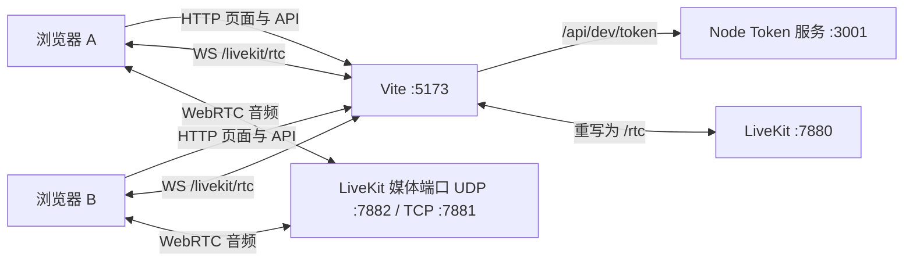
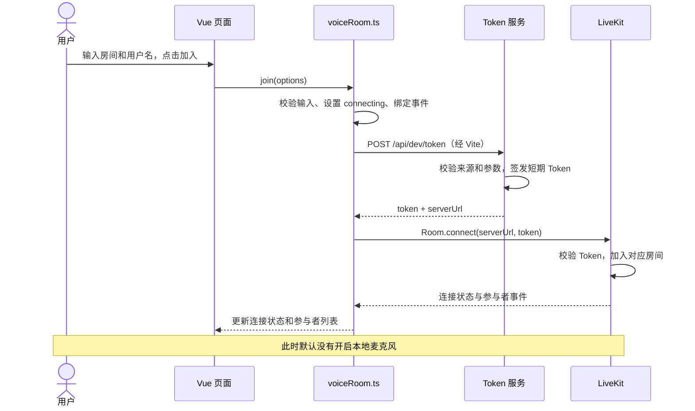
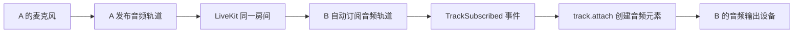

# 当前项目流程说明

本文对应当前已实现的第一阶段代码：用户手动加入同一个 LiveKit 房间，开启麦克风后进行实时语音通信。当前局域网模式使用 **HTTP + WS**，尚未实现登录、呼叫邀请、接听、拒绝或通话记录。

## 1. 项目由哪些部分组成

| 部分 | 主要文件 | 职责 |
| --- | --- | --- |
| 页面入口 | `frontend/src/main.ts`、`frontend/src/App.vue` | 展示连接表单、参与者、麦克风和错误提示，响应用户操作 |
| Token 请求层 | `frontend/src/services/token.ts` | 向服务端申请加入房间的 Token |
| 音频连接层 | `frontend/src/services/voiceRoom.ts` | 管理 LiveKit Room、状态、麦克风、音频订阅及资源清理 |
| 开发 Token 服务 | `dev-token-server/src/index.ts`、`server.ts` | 读取服务端配置，校验请求并签发 Token |
| 前端开发服务器 | `frontend/vite.config.ts` | 提供页面，将 API 和局域网 WS 信令转发到对应服务 |
| LiveKit Server | `deploy/compose.yaml`、`deploy/compose.lan.yaml` | 校验加入权限、管理房间和参与者、转发实时媒体 |
| 局域网配置脚本 | `scripts/setup-lan.mjs` | 根据服务器 IP 和凭据生成局域网环境配置 |

Token 服务不传输音频；Vite 代理页面请求和信令，不转发 WebRTC 音频媒体。实际音频通过浏览器与 LiveKit 之间的 WebRTC 连接传输。

## 2. 整体架构

以下以局域网模式为例：



信令负责加入房间、连接协商和状态交互；媒体连接负责声音传输。因此“网页能打开”“已加入房间”和“能够听到声音”是不同层次的检查结果。

## 3. 启动流程

### 3.1 首次准备

在项目根目录执行：

```powershell
npm.cmd install
# 仅首次创建，已有 .env 时不要覆盖
Copy-Item .env.example .env
```

`.env` 存放 LiveKit API Key、Secret、服务地址和 Token 端口。凭据必须与 LiveKit 配置一致，不能放入前端代码。

### 3.2 同机 localhost 模式

先启动 LiveKit，再分别在两个终端启动 Token 和前端：

```powershell
npm.cmd run livekit:up00000000000000
```

```powershell
npm.cmd run dev:token
```

```powershell
npm.cmd run dev
```

浏览器打开 `http://127.0.0.1:5173`。默认 Token 返回 `ws://localhost:7880`，浏览器直接连接本机 LiveKit 信令服务。

### 3.3 局域网 HTTP 模式

先停止旧的前端和 Token 进程，然后执行：

```powershell
# 替换为服务器真实以太网/Wi-Fi IPv4
npm.cmd run lan:setup -- 192.168.31.38
npm.cmd run livekit:lan:up
```

分别在两个终端运行：

```powershell
npm.cmd run dev:token:lan
```

```powershell
npm.cmd run dev:lan
```

配置脚本会完成以下工作：

1. 校验输入是否为私有 IPv4 地址。
2. 读取 `.env` 中的 LiveKit 凭据。
3. 生成 `.env.lan`，写入局域网 IP、`ws://服务器IP:5173/livekit` 和允许访问 Token 的 HTTP Origin。
4. 生成 `deploy/livekit.lan.yaml`，将媒体广播地址 `rtc.node_ip` 设置为服务器局域网 IP。

所有客户端打开 `http://服务器IP:5173`，不要填写客户端自己的 localhost。页面的 LiveKit 地址通常留空，使用 Token 服务返回的配置。

| 端口 | 用途 | LAN 模式访问方式 |
| --- | --- | --- |
| 5173/TCP | 页面、API 代理、WS 信令代理 | 客户端访问服务器局域网 IP |
| 3001/TCP | Token 服务，端口可配置 | 仅服务器回环地址，通过 Vite 代理访问 |
| 7880/TCP | LiveKit HTTP/WS 信令 | 仅服务器回环地址，通过 Vite 代理访问 |
| 7881/TCP | WebRTC TCP 媒体候选 | 局域网客户端可达 |
| 7882/UDP | WebRTC UDP 媒体 | 局域网客户端可达 |

两种模式使用相同服务端口，不应同时启动。IP 或凭据变化后重新生成 LAN 配置并重启服务。

## 4. 用户加入房间的流程



具体步骤：

1. `App.vue` 把房间名、用户名和可选的服务器地址传给 `join()`。
2. `join()` 阻止重复加入，校验必要输入，创建 Room 并注册事件。
3. `token.ts` 发送房间名和用户名；自定义服务器地址不参与 Token 签名请求。
4. Token 服务校验浏览器 Origin（如果请求包含 Origin）、POST 方法、JSON 类型、请求大小，以及名称长度和控制字符。
5. 服务使用官方 `livekit-server-sdk` 签发 Token，返回 Token 和 LiveKit 地址。
6. 前端优先使用用户手动填写的服务器地址，否则使用返回的 `serverUrl`；目标服务器需要匹配签发 Token 的凭据。
7. 调用 `Room.connect(..., { autoSubscribe: true })`。Token 请求有 15 秒超时，LiveKit 连接阶段由 SDK 管理。
8. SDK 建立信令和 WebRTC 连接后，页面根据事件显示连接状态和参与者。

当前设置 `singlePeerConnection: false`，使 SDK 使用 `/rtc`，适配固定部署的 LiveKit Server 1.9.9，避免先尝试不支持的 `/rtc/v1`。局域网中 `/livekit/rtc` 会被 Vite 重写为 `/rtc`。

## 5. Token 内包含哪些权限

请求示例：

```json
{
  "roomName": "voice-test",
  "participantName": "Alice"
}
```

返回结构示例：

```json
{
  "token": "签名后的 JWT",
  "serverUrl": "ws://192.168.31.38:5173/livekit"
}
```

| 配置 | 当前行为 |
| --- | --- |
| identity、name | 使用去除首尾空格后的用户名 |
| room | 只允许加入请求指定的房间 |
| 有效期 | 签发时设置为 10 分钟 |
| roomJoin | 允许加入房间 |
| canPublish / canSubscribe | 允许发布与订阅 |
| canPublishSources | 仅允许麦克风来源 |
| canPublishData | 不允许发布数据消息 |

Token 到期不等于通话在第 10 分钟强制结束；它不是项目实现的通话时长限制。同一房间应使用不同 identity，重复用户名可能导致旧连接被替换。

当前服务只是开发工具：没有登录或真实身份认证，Origin 白名单不等同于用户授权。

## 6. 开启麦克风与音频发送

1. 用户加入成功后点击“开启麦克风”。
2. `toggleMicrophone()` 检查连接状态、操作锁以及浏览器安全上下文。
3. 调用 `localParticipant.setMicrophoneEnabled(true)`，由 SDK 获取麦克风权限、创建并发布音频轨道。
4. 使用回声消除、降噪、自动增益的采集配置。
5. 浏览器将音频通过 WebRTC 发送给 LiveKit。
6. LiveKit 将轨道转发给同房间中已订阅的其他参与者。

点击“关闭麦克风”会调用 `setMicrophoneEnabled(false)`。配置 `stopMicTrackOnMute: true` 让 SDK 在静音时停止麦克风采集；之后可再次开启。

HTTP 局域网页面默认不是安全上下文，浏览器会限制麦克风。当前代码允许尝试加入和接收音频，在开启麦克风时给出限制提示。桌面 Chrome/Edge 的临时开发例外配置见 [LAN.md](deploy/LAN.md)，代码不会自动修改浏览器设置。没有该例外的浏览器不能保证 HTTP 双向通话。

## 7. 接收与播放远端音频



`autoSubscribe: true` 让 SDK 自动订阅其他参与者的轨道。应用处理 `TrackSubscribed` 时只接受音频轨道，通过 `track.attach()` 创建音频元素并加入页面容器；用集合避免重复挂载。

若浏览器限制自动播放，页面显示“启用声音”。用户点击后调用 `Room.startAudio()`，尝试恢复播放。

收到 `TrackUnsubscribed` 时，应用调用 `track.detach()`，移除对应元素及集合记录。B 向 A 发送声音遵循同样流程。不同房间的音频不会按此订阅链路互相转发。

## 8. 页面状态如何更新

| 事件或操作 | 页面变化 |
| --- | --- |
| 点击加入 | `connecting`，防止重复提交 |
| `ConnectionStateChanged` | 更新已连接、重连等状态 |
| 参与者加入或离开 | 重新生成参与者列表 |
| 轨道发布、取消发布、静音或取消静音 | 更新麦克风状态 |
| `ActiveSpeakersChanged` | 更新正在讲话的标记 |
| `AudioPlaybackStatusChanged` | 显示或隐藏“启用声音”按钮 |
| 用户离开 | `disconnecting`，最终恢复 `disconnected` |
| SDK 最终断开 | 清理状态并显示断开提示 |

网络波动时，SDK 可以进入重连流程。最终断开后，本应用不无限循环重新申请 Token，用户可重新点击加入。

## 9. 退出、取消与资源清理

点击离开、连接中取消、页面触发 `pagehide`，或 Vue 组件卸载时，会调用 `leave()`：

1. 增加 `generation`，使之前的异步操作失效。
2. 通过 `AbortController` 取消尚未完成的 Token 请求。
3. 清除当前 Room 引用，进入离开状态。
4. 移除事件监听，detach 远端音频并清空 DOM 容器。
5. 清空参与者、麦克风和播放提示状态。
6. 调用 `room.disconnect(true)`，请求 SDK 断开并停止本地轨道。
7. 恢复未连接状态，允许再次加入。

如果旧的连接请求在取消后才返回，代码会识别其 generation 已过期，不把它当成当前连接。若麦克风开启操作在离开后才完成，也会停止旧 Room 的相关本地轨道。页面关闭时无法保证异步操作全部执行完成，浏览器自身还会释放页面持有的媒体和网络资源。

## 10. 排查问题的顺序

| 现象 | 优先检查 |
| --- | --- |
| 页面打不开 | Vite 是否启动、访问 IP 是否正确、5173 端口和防火墙 |
| Token 获取失败 | Token 服务、Vite API 代理、Origin 白名单、请求参数 |
| 加入失败 | Token 与 LiveKit 凭据是否一致、WS 地址、LiveKit 日志 |
| `/rtc/v1` 返回 404 | 是否加载了设置 `singlePeerConnection: false` 的最新前端代码 |
| 麦克风无法开启 | HTTP 开发例外、网站和系统权限、设备连接及占用 |
| 已连接但没有声音 | 两端麦克风、自动播放、输出设备、媒体 IP 和 7881/7882 端口 |
| 同名用户被断开 | 同一房间是否重复使用 identity |

检查命令：

```powershell
npm.cmd test
npm.cmd run build
docker compose --env-file .env.lan -f deploy/compose.lan.yaml logs --tail 50
```

已有自动测试覆盖 Token 签名及授权、非法请求、连接取消、麦克风控制、HTTP 限制和音频资源清理；信令握手也已做过实际检查。这些不能替代两台设备的真实双向声音验收，人工步骤见 [README.md](README.md) 和 [LAN.md](deploy/LAN.md)。

## 11. 后续接入 Spring Boot 的位置

第二阶段由 Spring Boot 替换 `dev-token-server`，承担登录认证、真实用户 identity、房间访问权限和 Token 签发。前端主要调整 `services/token.ts` 及 API 代理；现有 `voiceRoom.ts` 音频连接层可以复用。

呼叫邀请、接听、拒绝属于尚未实现的业务流程，应在后续单独增加，不应与当前“手动加入同一房间”的流程混淆。
