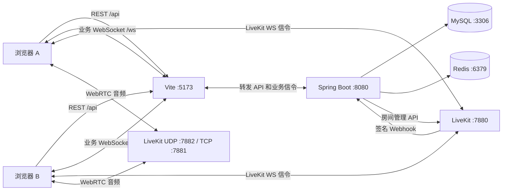
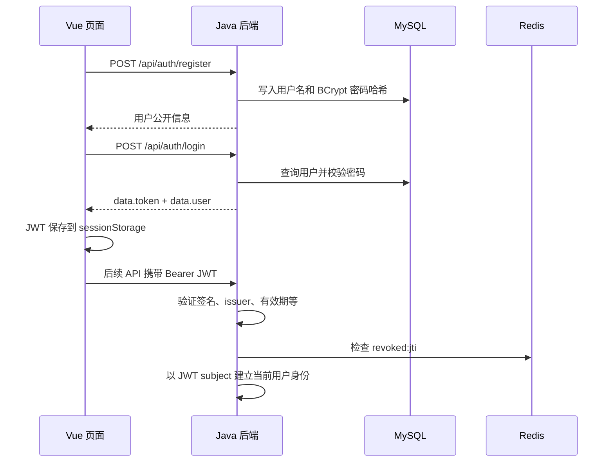
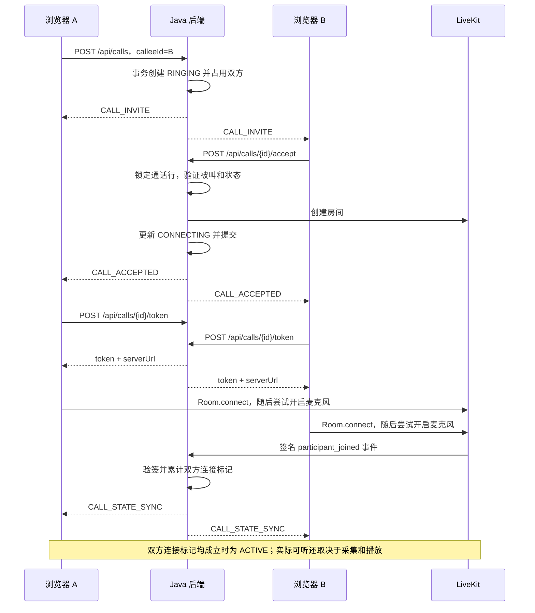
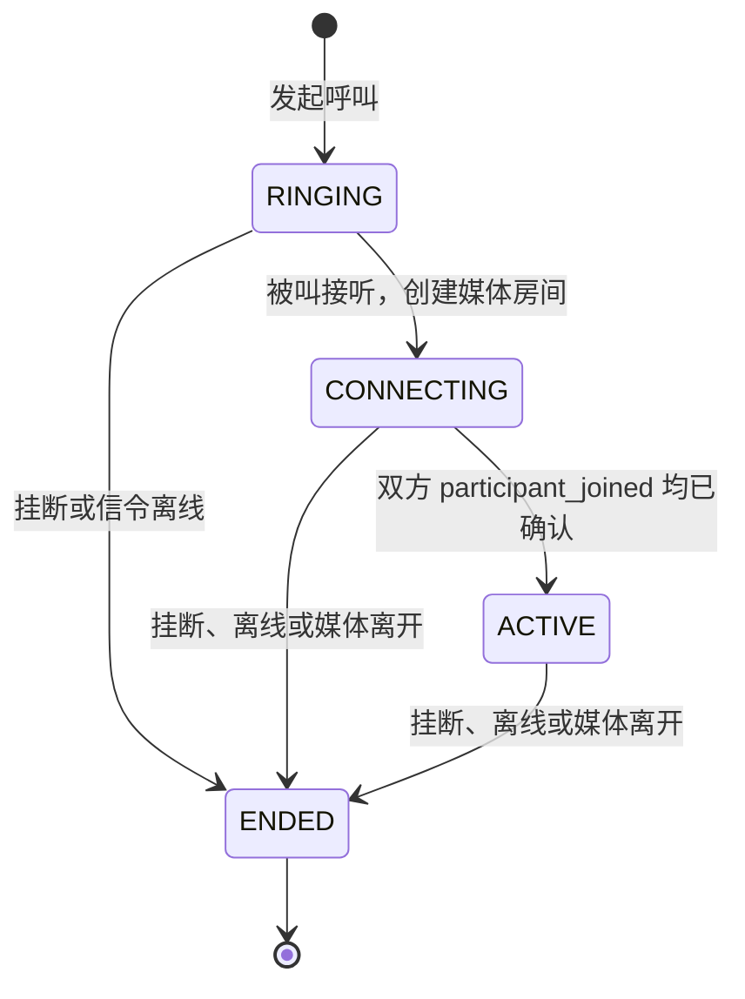

# 当前项目流程说明（第二阶段）

本文对应当前 Vue + Spring Boot + MySQL + Redis + LiveKit 实现。主流程是：**注册登录 → 建立业务信令连接 → 发起呼叫 → 接听 → 获取媒体凭证 → 建立音频连接 → 挂断清理**。

第一阶段的音频封装继续复用；`dev-token-server` 仅保留为独立开发工具，正式页面不依赖它。本文描述代码行为，不代表真实双浏览器音频链路已经完成验收。

## 1. 模块与职责

| 模块 | 关键文件 | 职责 |
| --- | --- | --- |
| 页面 | `frontend/src/App.vue`、`components/LoginForm.vue` | 登录注册、用户列表、来电、接听、挂断、麦克风与错误提示 |
| 通话编排 | `frontend/src/services/useCalling.ts` | 协调认证、信令、媒体连接、通话计时和退出 |
| HTTP 客户端 | `frontend/src/services/api.ts` | 保存登录 JWT、添加 Authorization、读取统一响应 |
| 业务信令客户端 | `frontend/src/services/signaling.ts` | 申请 Ticket、连接 WebSocket、接收通话快照、发送心跳 |
| 音频连接 | `frontend/src/services/voiceRoom.ts` | LiveKit Room、音轨发布订阅、播放和资源释放 |
| 安全配置 | `backend/src/main/java/com/smartrtvc/config/SecurityConfig.java` | JWT 过滤器、无状态认证、接口访问控制 |
| 认证与用户 | 后端 `auth/`、`user/` | BCrypt 注册登录、JWT 签发和撤销、用户查询 |
| 信令与在线状态 | 后端 `signaling/`、`config/WebSocketConfig.java` | 一次性 Ticket 握手、Origin 校验、单设备会话、Redis 在线 TTL |
| 通话业务 | 后端 `call/CallService.java`、`CallMapper.java` | 成员权限、并发占用、状态流转、事务后推送 |
| LiveKit 集成 | 后端 `livekit/LiveKitService.java` | 房间管理、媒体 Token 签发、Webhook 验签 |
| 统一响应 | 后端 `common/Api.java`、`Errors.java` | `{data, error}` 响应、参数及异常处理 |
| 部署 | `deploy/compose.yaml`、`compose.stage2.yaml`、`scripts/setup-stage2.mjs` | 基础设施、后端容器和本地配置生成 |

## 2. 三条通信链路



- **REST API**：发起业务操作，例如登录、呼叫、接听、挂断和申请媒体 Token。
- **业务 WebSocket**：Java 将通话状态实时推送到双方；不承载音频，也不交换 WebRTC SDP/ICE。
- **LiveKit 连接**：SDK 使用自己的信令连接协商 WebRTC，音频通过浏览器与 LiveKit 的媒体连接传输。

Java 后端和 Vite 不转发音频。业务在线、媒体连接成功、麦克风已发布、远端能听到声音，是需要分别确认的状态。

## 3. 启动与配置流程

在项目根目录执行，需先启动 Docker Desktop：

```powershell
npm.cmd ci
# 仅首次生成；已有配置时跳过，不覆盖现有密钥
node scripts/setup-stage2.mjs

docker compose --env-file .env.stage2 -f deploy/compose.yaml -f deploy/compose.stage2.yaml up -d --build
npm.cmd run dev
```

浏览器统一访问 `http://127.0.0.1:5173`，默认 WebSocket Origin 配置与此一致。正式流程无需运行 `npm.cmd run dev:token`。

配置脚本生成 `.env.stage2` 和 `deploy/livekit.stage2.yaml`：前者保存随机数据库密码、JWT Secret 和 LiveKit 凭据；后者沿用本地媒体网络配置，加入相同 LiveKit 凭据及 `http://backend:8080/api/livekit/webhook` 回调地址。两者均被 Git 忽略。

Compose 的 backend 等待 MySQL、Redis 健康检查及 LiveKit 容器启动；这不等于已经完成所有媒体链路检查。Spring Boot 使用 `schema.sql` 创建数据库表，启动完成后结束遗留的未结束通话。Vite 将 `/api` 和 `/ws` 转发到本机 8080。

| 服务 | 本机访问 | 容器间访问 |
| --- | --- | --- |
| 前端 | `http://127.0.0.1:5173` | 本机运行 |
| Java 后端 | `http://127.0.0.1:8080` | `backend:8080` |
| LiveKit 信令/API | `ws://127.0.0.1:7880` | `http://livekit:7880` |
| MySQL | `127.0.0.1:3306` | `mysql:3306` |
| Redis | `127.0.0.1:6379` | `redis:6379` |
| LiveKit 媒体 | TCP 7881、UDP 7882 | 由 WebRTC 选择可达候选 |

当前第二阶段默认针对同机双浏览器。历史 LAN 配置仍保留，但不能只运行旧的 LAN 启动命令就认为第二阶段已支持手机访问；还需调整 Origin、外部 LiveKit 地址、端口映射、媒体广播地址及 HTTPS/WSS。手机的 localhost 指向手机自身。

## 4. 注册、登录与 HTTP 认证



“注册并登录”按钮实际顺序执行注册和登录两个请求。用户名限制为 3–32 位字母、数字或下划线，密码参数长度限制为 8–64。数据库不保存明文密码，返回用户信息时不包含密码哈希。

登录 JWT 有效期为 **2 小时**，subject 是服务端用户 ID。HTTP 过滤器将该 ID 放入 Spring Security 的 Authentication，通话接口不会信任客户端提交的当前用户 ID。

页面刷新时，前端读取 sessionStorage，调用 `/api/users/me` 恢复用户信息，再建立信令连接。用户列表通过 `/api/users` 获取，并每 5 秒刷新；它是测试用户列表，不是好友系统。

独立浏览器会话不共享此登录存储；复制标签页可能继承初始 sessionStorage。双用户测试建议使用 Chrome 和 Edge，或独立隐私会话。

## 5. WebSocket Ticket 与在线状态

1. 前端携带登录 JWT 调用 `POST /api/ws/ticket`。
2. 后端生成随机 Ticket，在 Redis 写入 `ticket:<ticket> → userId`，有效期 **30 秒**。
3. 前端连接同源 `/ws?ticket=...`，Vite 转发到 Java。
4. `WebSocketConfig` 限制 Origin；`TicketInterceptor` 调用 Redis `getAndDelete` 原子消费 Ticket，缺失或已消费则拒绝握手。
5. 握手用户身份来自 Ticket 对应的服务端记录；URL 中即使附带伪造 userId，也不用于认证。长期 JWT 不放入 WebSocket URL。
6. `Signaling` 保存当前用户的会话，写入 `online:<userId> → sessionId`，TTL 为 **60 秒**。
7. 新设备连接同一用户时替换旧会话，旧会话关闭回调不会删除新会话的在线记录。

前端每 **15 秒**发送文本 `ping`，后端回复 `{"type":"PONG"}` 并更新心跳时间。后端每 **20 秒**检查一次会话：超过 60 秒没有心跳则关闭，否则刷新在线 TTL。由于按周期检查，不能将 60 秒理解为精确到秒的离线通知时间。

在线判断同时依赖本机内存会话与 Redis 标记，因此当前是**单 Java 实例**方案。连接建立时后端会推送已有通话快照，前端也查询 `/api/calls/current`；这只是基础同步，不是完整的断线补偿系统。

## 6. A 呼叫 B：创建通话与防止并发占用

A 点击用户列表中的“呼叫”，前端发送：

```http
POST /api/calls
Authorization: Bearer <登录 JWT>
Content-Type: application/json

{"calleeId": 2}
```

`CallService.invite()` 按以下顺序处理：

1. 从认证上下文取得主叫 ID，拒绝呼叫自己。
2. 检查双方用户存在，并且双方业务信令在线。
3. 生成 UUID `callId`，房间名设置为 `call-<callId>`。
4. 写入 `call_session`，初始状态为 `RINGING`。
5. 按用户 ID 从小到大插入双方 `user_call` 占用记录；`user_id` 是主键，一个用户只能占用一个通话。
6. 任一占用冲突则事务回滚，避免留下只占用一方的通话；固定插入顺序也有助于减少交叉竞争。
7. 事务提交后向双方推送 `CALL_INVITE`，REST 同时返回通话快照。

收到快照后，主叫显示呼叫中，被叫显示来电和接听按钮。当前 RINGING 阶段仅生成业务房间名，尚未通过 LiveKit API 创建媒体房间。

## 7. 接听、申请凭证与建立媒体连接



接听接口使用 `SELECT ... FOR UPDATE` 锁住通话行，只有被叫可以接听。重复接听 CONNECTING 或 ACTIVE 通话直接返回现状；已结束通话不能再次接听。LiveKit 创建房间成功后，才将状态改为 CONNECTING 并记录 `accepted_at`。

双方的 `useCalling.update()` 收到 CONNECTING 或 ACTIVE 时，分别申请自己的媒体 Token。`joining` 防止对同一通话重复加入，`generation` 防止过期异步操作继续处理；状态顺序检查避免较旧的同通话响应把 ACTIVE 回退为 CONNECTING。

Token 接口会检查：通话存在、当前用户属于通话、状态是 CONNECTING 或 ACTIVE。客户端只提交 callId，不能指定任意房间或替别人申请身份。

| 媒体 Token 字段 | 当前值 |
| --- | --- |
| identity | 当前认证用户 ID 的字符串形式 |
| room | 对应通话的服务端房间名 |
| 有效期 | 签发时设置为 60 秒 |
| roomJoin | true |
| canPublish / canSubscribe | true |
| canPublishSources | 仅 microphone |
| canPublishData | false |

媒体 Token 与登录 JWT 用途不同；60 秒不是通话时长限制。签名密钥只在 Java/LiveKit 服务端配置中。

前端将 `{token, serverUrl}` 作为 `credentials` 传给原有 `voiceRoom.join()`，因此正式流程跳过 `requestToken()` 的开发接口。`token.ts` 中的旧接口仅保留作未传入 credentials 时的开发回退。

## 8. ACTIVE 的来源与通话状态



`LiveKitService.webhook()` 使用官方 SDK 对 Authorization 和原始请求体进行验签。`CallService.webhook()` 根据房间查找并锁定通话，再检查参与者 identity 是否为双方之一。

- CONNECTING 状态收到 `participant_joined`，设置对应一方的连接标记并推送同步。
- 双方标记均为 true，设置 ACTIVE 和 `active_at`。
- 合法参与者的 `participant_left` 会走挂断流程。
- 已结束通话收到事件，不恢复通话，而是再次安排房间清理。

ACTIVE 表示此实现已收到双方参与者连接事件，**不表示麦克风权限必然允许，也不保证双方已经听见声音**。当前没有以音轨发布或播放成功作为 ACTIVE 的附加条件。

前端第一次收到 ACTIVE 时用本地 `Date.now()` 开始计时，每秒更新显示；它不是基于服务端 `active_at` 恢复的精确历史通话时长。

## 9. 麦克风、订阅与播放

`voiceRoom.ts` 仍负责媒体层，`useCalling.ts` 负责何时进入或离开媒体房间：

1. 创建 Room 并注册事件，使用 `autoSubscribe: true` 连接 LiveKit。
2. 正式呼叫流程连接成功后自动尝试开启麦克风，触发浏览器权限请求；原始 `join()` 方法本身不自动开麦。
3. 开启麦克风时调用 `setMicrophoneEnabled(true)`，使用回声消除、降噪和自动增益配置。
4. 发布音频经 LiveKit 转发给另一方。只处理音频轨道，不采集视频。
5. 收到 `TrackSubscribed` 后调用 `track.attach()` 挂载音频元素，用集合防止重复挂载。
6. 自动播放受限时显示“启用声音”，点击后调用 `Room.startAudio()`。
7. 关闭麦克风调用 `setMicrophoneEnabled(false)`；`stopMicTrackOnMute: true` 用于停止静音时的采集。
8. 取消订阅时 `detach()` 并删除音频元素。

麦克风权限拒绝会显示错误，通常仍保留房间接收能力，可以调整权限后重试。媒体连接失败则由通话编排尝试挂断。页面另行显示 SDK 的连接状态，不能将它与业务通话状态混为一谈。

## 10. 挂断、注销和异常清理

### 主动挂断

前端先使旧异步流程失效并执行 `voice.leave()`，再请求 `POST /api/calls/{id}/hangup`。后端锁定通话、校验参与者，将状态更新为 ENDED，记录 `ended_at`、释放双方 `user_call` 占用，提交后推送 `CALL_ENDED`。

另一方收到 ENDED 后也会离开媒体房间。重复挂断返回已有状态；接口失败时前端提示重试，不能只因本地音频已关闭就认为服务端一定结束成功。

### 媒体资源释放

`voiceRoom.leave()` 会增加代次、取消其内部尚未完成的开发 Token 请求、移除 Room 事件监听、detach 远端音轨、清空音频容器及参与者状态，并执行 `disconnect(true)`。Java Token 请求由 `api.ts` 发出，当前没有接入该 AbortController，而是由编排代次检查忽略迟到结果。

若麦克风授权在离开后才返回，媒体封装会停止旧房间的本地音轨。组件卸载时还清理轮询、计时器和音频容器；`pagehide` 会关闭业务信令并释放媒体。页面关闭不能保证所有异步操作都执行完毕，服务端仍需依靠断开事件或心跳处理离线。

### 信令断开、重启与房间清理

- 当前有效信令会话离线时，`Signaling` 发出 Offline 事件，`CallService.offline()` 用新事务结束该用户当前通话。
- 前端信令断开立即释放音频并提示重新连接；重新连接会重新申请 Ticket 和查询当前通话，不承诺保留原通话。
- 后端启动完成后结束所有非 ENDED 记录，防止上次退出留下永久占用。
- 定时任务每 5 秒尝试删除待清理的 LiveKit 房间，并重新收集最近 2 分钟结束的房间；删除失败保留重试，404 视为已不存在。
- 清理不是与数据库同一事务中的即时动作，媒体 Token 也不是挂断时立刻撤销；当前依靠短 Token 有效期、客户端退出和房间清理缩短残留窗口。

退出登录先尝试挂断，再调用 `/api/auth/logout`，后端将 JWT 的 jti 写入 Redis 撤销记录，TTL 为其剩余有效期，并关闭信令。前端最终清除自己的登录存储。当前各类结束路径统一记为 `HANGUP`，尚未细分取消、拒接、超时或故障原因。

## 11. 数据与接口速查

| 存储 | 数据 | 用途 |
| --- | --- | --- |
| MySQL `app_user` | ID、唯一用户名、密码哈希、时间字段 | 用户身份 |
| MySQL `call_session` | 双方 ID、房间、状态、连接标记、结束原因及时间 | 通话状态 |
| MySQL `user_call` | 唯一 user_id、call_id | 有效通话占用，结束后释放 |
| Redis `ticket:*` | userId，30 秒 | 一次性握手凭证 |
| Redis `online:*` | sessionId，60 秒 | 在线标记 |
| Redis `revoked:*` | 撤销标记，JWT 剩余有效期 | 注销 JWT |

SQL 定义见 `backend/src/main/resources/schema.sql`。

| 方法 | 路径 | 功能 |
| --- | --- | --- |
| POST | `/api/auth/register`、`/api/auth/login` | 注册、登录 |
| POST | `/api/auth/logout` | 注销当前 JWT |
| GET | `/api/users/me`、`/api/users`、`/api/users/{id}` | 当前用户、最多 200 名测试用户、指定用户 |
| POST | `/api/ws/ticket` | 申请信令 Ticket |
| POST | `/api/calls` | 发起呼叫 |
| GET | `/api/calls/current`、`/api/calls/{id}` | 当前通话、指定通话 |
| POST | `/api/calls/{id}/accept`、`/hangup`、`/token` | 接听、挂断、媒体凭证 |
| POST | `/api/livekit/webhook` | 验签处理媒体事件 |

业务信令统一结构：

```json
{
  "eventId": "唯一事件 ID",
  "type": "CALL_STATE_SYNC",
  "callId": "通话 UUID",
  "timestamp": 0,
  "data": { "id": "通话 UUID", "state": "ACTIVE" }
}
```

通话事件 data 实际是完整通话快照，上例仅展示部分字段。事件包括 CALL_INVITE、CALL_ACCEPTED、CALL_STATE_SYNC、CALL_ENDED；不支持的客户端信令消息返回 ERROR。普通业务操作失败通过 REST `{data, error}` 返回；心跳 PONG 使用简化结构，不包含完整事件字段。

## 12. 验收和排查顺序

使用两个独立浏览器会话注册不同账号，确认双方信令在线后，依次验证呼叫、来电、接听、麦克风授权、ACTIVE、双向声音、静音切换、挂断及再次呼叫。建议佩戴耳机避免同机回声。

| 现象 | 优先检查 |
| --- | --- |
| Docker 构建时拉取镜像超时 | Docker Hub 网络与 Docker Desktop 代理；尚未进入业务代码阶段 |
| 页面无法访问 | Vite、5173 端口和访问地址 |
| 登录或用户列表失败 | Java 是否启动、MySQL/Redis 可用性、Vite `/api` 代理、JWT 是否过期 |
| WebSocket 握手失败 | 页面 Origin、Ticket 是否过期/重复消费、Redis、`/ws` 代理 |
| 用户显示离线 | 双方是否建立业务信令、心跳是否持续、是否被另一设备替换 |
| 呼叫失败 | 用户存在性、自呼叫、双方在线、是否已有通话占用 |
| 接听失败 | 是否由被叫操作、LiveKit 内部地址及服务端凭据 |
| 一直 CONNECTING | 双方媒体连接、LiveKit Webhook 地址是否可达、签名与用户 identity |
| ACTIVE 但没有声音 | 麦克风权限/静音、自动播放、输出设备、媒体 IP 和 7881/7882 端口 |
| 页面已退出但对方暂未结束 | 信令关闭/心跳检测延迟、Webhook、后端服务状态 |

```powershell
npm.cmd test
npm.cmd run build
mvn -f backend/pom.xml verify

docker compose --env-file .env.stage2 -f deploy/compose.yaml -f deploy/compose.stage2.yaml logs --tail 100 backend livekit
```

自动化测试与此前运行环境记录见 [docs/STAGE2-VALIDATION.md](docs/STAGE2-VALIDATION.md)，完整启动和人工验收见 [README.md](README.md)。历史环境记录不是当前 Docker 运行状态的实时检测；本文更新没有重新执行端到端测试。

## 13. 当前边界

已实现基础一对一呼叫链路，尚未实现完整的拒接/取消事件、无人接听超时、自动断线恢复、多设备并存、多实例协调和历史记录页面。RINGING 没有自动超时，需要主动挂断或通过离线处理结束。已有事件 ID，但没有完整的事件持久化、乱序去重和重放机制。

后续可优先补充结束原因和超时调度、持久化媒体清理任务、Webhook 重放/乱序处理、状态恢复和真实多网络环境音频验收。第一阶段历史部署说明保留在 [docs/STAGE1.md](docs/STAGE1.md)，不再作为当前正式页面的启动流程。
